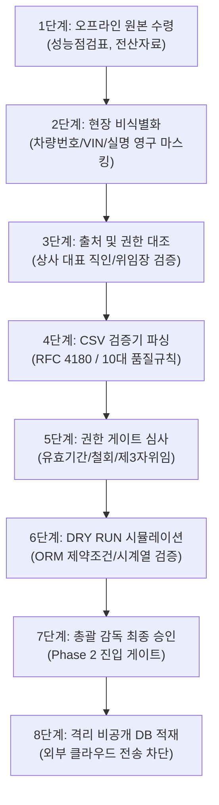

# 🛡️ 비공개 실매물 파일럿 데이터 안전 인입 가이드 (PRIVATE PILOT INTAKE GUIDE)

본 문서는 장안평 파트너 등 외부 현장에서 실제 매물 데이터가 유입될 때 개인정보를 철저히 보호하고, 검증되지 않은 데이터의 무단 유입을 차단하기 위한 8단계 비공개 인입 절차서입니다.

---

## 1. 8단계 안전 인입 파이프라인 (8-Stage Safety Pipeline)

### 단계별 세부 절차
1. **1단계 (오프라인 원본 수령):** 파트너 딜러로부터 공인 성능상태점검기록부 및 상사 매입 확인 서류를 종이 또는 격리 오프라인 채널로 수령.
2. **2단계 (현장 비식별화):** 실차량번호, 차대번호(VIN), 차주/딜러 성명, 전화번호, 주민등록번호는 즉시 디지털 영구 마스킹 처리하여 내부 익명 코드(`ANON_...`)로 전환. 원본 민감정보의 시스템 입력 원천 차단.
3. **3단계 (출처 및 권한 대조):** 상사 대표 직인이 날인된 서면 위임장 및 제3자 상사 매물인 경우 해당 상사의 동의서를 육안 대조 검증.
4. **4단계 (CSV 검증기 파싱):** `PartnerListingIntakeValidator`를 통해 필수 헤더, 음수 가격/주행거리 차단, PII 컬럼 유입 여부, quoted multiline 무결성 검증.
5. **5단계 (권한 게이트 심사):** 위임 유효기간 경과 여부, 철회 여부를 심사하며, 광고 게시 허가(`is_live_ad_authorized`)는 항상 `False`로 동결.
6. **6단계 (DRY RUN 시뮬레이션):** 별도 SQLite 인메모리 세션에서 ORM 엔티티를 생성하고 `flush()`하여 DB 제약조건 통과를 실증한 후 즉시 `rollback()`.
7. **7단계 (총괄 감독 최종 승인):** 사장님(총괄 감독)의 명시적 서면 승인이 떨어진 매물에 한해서만 Phase 2(실데이터 인입) 허가.
8. **8단계 (격리 비공개 DB 적재):** 로컬 격리 SQLite DB에 적재하며, 외부 상용 클라우드나 공개 저장소로의 업로드는 일체 금지.

---

## 2. 데이터 보관 및 파기 정책 (Retention & Deletion Policy)

1. **보관 원칙:** 비식별화된 제원 데이터 및 시계열 스냅샷은 AI 가치 추정 모델의 학습 연구를 위해 안전하게 격리 보관됩니다.
2. **파기 요청:** 파트너 딜러 또는 상사 대표가 데이터 제공 철회나 삭제를 요청할 경우, 접수 즉시 해당 매물은 `DELISTED`로 영구 비활성화되며, 비공개 격리 저장소의 관련 파일은 7일 이내에 영구 폐기 처리됩니다.
3. **공개 저장소 격리:** GitHub 등 공개 레포지토리에는 오직 `UNVERIFIED` 메타데이터 및 합성 샘플만 공개되며, 실제 매물 데이터는 `.gitignore` 처리된 로컬 격리 볼륨에만 유지됩니다.
