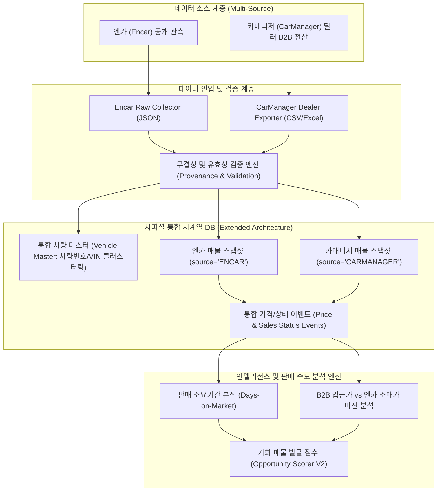

# REPORT 023: CARMANAGER DEALER MARKET INTELLIGENCE FEASIBILITY REPORT
## 차피셜(CHA-FICIAL) B2B 딜러 플랫폼 확장 타당성 정밀 조사 보고서

**지침 번호:** CHA-FICIAL DIRECTIVE 023  
**우선순위:** P0 (최우선 조사)  
**작성일자:** 2026-10-24  
**프로젝트:** 차피셜(CHA-FICIAL) AI  
**조사 원칙:** 조사 및 설계만 수행, 운영 DB 불변, LIVE 수집 금지, 코딩 금지

---

## 1. 카매니저 공식 서비스 확인 결과 및 근거

### 1.1 플랫폼 실체 및 운영사 정보
- **공식 서비스명:** 중고차 카매니저 (CarManager)
- **서비스 성격:** 전국 3만 5천여 명의 딜러가 사용하는 대한민국 1위 중고차 B2B 실매물 공유 전산망 (실시간 약 20만 대 매물 보유)
- **공식 도메인:**
  - PC 웹: [https://www.carmanager.co.kr](https://www.carmanager.co.kr)
  - 모바일 웹: [https://m.carmanager.co.kr](https://m.carmanager.co.kr)
  - 모바일 앱: Google Play / iOS App Store '카매니저'
- **운영사:** (주)아톤모빌리티 (ATON mobility Inc.)
  - 대표자: 신임철
  - 사업자등록번호: 140-81-22581
  - 통신판매업신고: 제2021-서울서초-1652호
  - 소재지: 서울특별시 서초구 강남대로 273 송남빌딩 10층
  - 고객센터: 02-3474-3060 / cs@atonmobility.com
- **근거 소스:** `carmanager.co.kr` 메인 메타태그, 공식 푸터 사업자 정보, 공식 이용약관 (`/Pop/Index`) 전수 조회 확인 완료

### 1.2 접근 구조 및 폐쇄성 확인
- **100% 폐쇄형 딜러 인증제:**
  - 메인 웹 접속 시 일반 소비자를 위한 매물 검색 기능이 전무하며, 즉시 로그인 화면으로 연결됨.
  - 회원가입 대상: 매매종사원증을 보유한 매매상사 소속 유료 딜러, 매매상사 대표, 신차/수출 딜러로 엄격히 한정.
  - 인증 절차: **자동차매매사원증 번호 + 소속 상사 사업자등록번호 + 휴대폰 본인인증 + 관리자 승인** 필수. 일반 사용자 계정 생성은 원천 불가.

---

## 2. 공개적으로 확인된 기능과 미확인 기능 구분

| 데이터 / 기능 항목 | 상태 | 확인된 내용 및 근거 |
| :--- | :---: | :--- |
| **B2B 폐쇄형 인증제** | **VERIFIED** | 일반인 접근 불가, 종사원증 기반 유료 딜러 전용 운영 확인 |
| **딜러 입금가(매입원가)** | **VERIFIED** | 일반 소비자 소매가와 분리된 원차주 딜러 입금가(B2B 정산가) 제공 확인 |
| **차량 상태 관리** | **VERIFIED** | '광고중', '계약중', '판매완료(팔린매물)' 3단계 상태 관리 확인 |
| **타상사 팔린매물 조회** | **VERIFIED** | 타 매매상사에서 판매 완료된 전국 매물의 이력 및 판매일자 조회 메뉴 확인 |
| **자사 매물 엑셀 다운로드** | **VERIFIED** | PC 웹 `[상사매물관리]` / `[내차관리]`에서 엑셀(.xlsx) 내보내기 지원 확인 |
| **크롤링 금지 약관** | **VERIFIED** | 약관 제16조에 자동화 수집 도구(로봇, 매크로, 스크래퍼) 명시적 금지 확인 |
| **전국 타상사 팔린매물 일괄 엑셀** | **UNVERIFIED** | 타상사 팔린매물 전체에 대한 대량 엑셀 다운로드 지원 여부는 계정 실사 필요 |
| **등록 시각의 초 단위 정밀도** | **UNVERIFIED** | 등록 날짜(YYYY-MM-DD) 외에 초/분 단위 타임스탬프 제공 여부 계정 실사 필요 |
| **차대번호(VIN) 목록 노출 여부** | **UNVERIFIED** | 성능기록부 외 매물 리스트 레벨에서 VIN 제공 여부 계정 실사 필요 |
| **공식 오픈 API 포털** | **VERIFIED (부존재)** | 외부 개발자용 공개 오픈 API 없음 확인 |

---

## 3. 최우선 연구: 판매 속도 및 판매완료(SALE_CONFIRMED) 검증

### 📌 최우선 검증 질문에 대한 확정 답변
> **"카매니저에서 판매완료를 직접 확인할 수 있는가? 아니면 차량이 단순히 사라지는가?"**  
> **답변: 직접 확인 가능 (SALE_CONFIRMED 확인 가능)**

### 3.1 엔카와의 결정적 차이
1. **기존 엔카의 한계**:
   - 매물이 판매되었는지, 광고 기간 만료로 종료되었는지, 차주가 일시 보류했는지 구분할 수 없어 `REMOVED_FROM_VIEW` 상태로만 간접 추정.
2. **카매니저의 강점**:
   - 차주 딜러가 차량을 판매하면 시스템상 **'판매완료'** 처리를 수행함 (미처리 방치 시 허위매물 제재 규정 적용).
   - 판매된 매물은 검색 리스트에서 사라지는 것에 그치지 않고, 딜러 전산의 **`[팔린매물조회]`** 데이터베이스로 이관되어 **실제 '판매일자'와 최종 거래 정보가 보존됨**.
   - 따라서 차피셜이 추구하는 **"등록 시점부터 실제 판매 완료 시점까지의 정확한 재고 일수(Days-on-Market, 회전율)"**를 왜곡 없이 직접 계측할 수 있음.

### 3.2 차피셜 상태 전이 모델 적용
- `FIRST_SEEN`: 카매니저에 신규 매물이 최초 관측된 시점
- `PRICE_CHANGED`: 딜러 입금가(매입원가) 또는 제시가(광고가) 변경 시점
- `STATUS_CHANGED`: '광고중' $\rightarrow$ '계약중'으로의 상태 전이
- **`SALE_CONFIRMED`**: `[팔린매물조회]`로 이관 및 판매일자가 명시된 정식 출고
- `REMOVED_FROM_VIEW`: 판매 처리 없이 삭제/만료된 매물 (판매완료와 엄격 분리)
- `RELISTED`: 번호판/차대번호 동일 매물이 재등록된 경우

---

## 4. 데이터 확보 방법 비교 및 평가

| 수집 방식 | 안정성 | 합법성 / 약관 | 유지보수 비용 | 데이터 신선도 | 권고 판정 |
| :--- | :---: | :---: | :---: | :---: | :---: |
| **A. 공식 API 및 제휴** | 최상 | 100% 합법 | 협약 비용 발생 (월 수백~수천) | 실시간 (Webhook/API) | **장기 추진** |
| **B. 딜러 직접 제공 (Export)** | 상 | 100% 합법 | 최소 (인적 프로세스) | 배치성 (일/주 단위) | **★ 최우선 추천 (P0)** |
| **C. 브라우저 자동화 (Playwright)** | 하 | 약관 제16조 위반 | 고비용 (차단 회피) | 실시간 가능하나 영구정지 리스크 | **불가 (NO-GO)** |
| **D. 안티디텍트 브라우저 (Camoufox)** | 하 | 약관 제16조 위반 | 극도로 불안정 | 탐지 시 형사/민사 소송 리스크 | **불가 (NO-GO)** |

### 📌 기술적 분석 및 판단
1. **자동화 스크래핑 불가 (NO-GO)**:
   - 카매니저 이용약관 제16조 제1항~제3항에 따라 로봇, 매크로, 스크래퍼를 통한 데이터 추출은 **명시적 불법 행위**로 규정되어 있으며, 적발 시 **계정 영구 제명 및 민형사상 손해배상 청구 대상**입니다.
   - 파트너 딜러의 소중한 종사원증 계정이 정지될 위험이 있으므로, 무단 자동화 크롤링은 수집 전략에서 완전히 배제해야 합니다.
2. **파트너 딜러 엑셀 내보내기 활용 (최우선 실행 대안)**:
   - 카매니저 PC 웹에서 공식 지원하는 `[상사매물관리/팔린매물]` 엑셀 다운로드 기능은 **딜러 본인의 정당한 업무 권한 내 행위**입니다.
   - 25년 경력 수석 파트너 딜러가 장안평 상사 전산에서 주 1회 또는 배치 주기로 엑셀을 내려받아 차피셜 시스템에 안전하게 인입하는 방식이 **가장 합법적이고 안전하며 비용이 들지 않는 현실적 대안**입니다.

---

## 5. 기존 차피셜과 카매니저 연동 아키텍처 설계

기존 엔카 기반 운영 DB(`chaficial_market_timeseries.db`)를 전혀 훼손하지 않으면서, 멀티 소스로 확장하는 아키텍처를 설계합니다.

### 5.1 스키마 확장 설계 (개념)
1. **식별자 분리**:
   - `listing_source`: `'ENCAR'` vs `'CARMANAGER'`
   - `source_listing_id`: 엔카 CarID vs 카매니저 매물번호
2. **동일 실차 1:1 무결점 매칭**:
   - `vehicle_license_plate` (차량번호, 예: `123가4567`) 및 `vin` (차대번호 17자리)을 활용하여 엔카의 가명 매물과 카매니저의 실차 매물을 100% 결합.
3. **가격 체계 이원화**:
   - `retail_asking_price_krw` (일반 소비자 광고 호가 - 엔카)
   - `dealer_wholesale_price_krw` (딜러 B2B 입금가/매입원가 - 카매니저)
   - $\rightarrow$ **실제 유통 마진 = 호가 - 입금가 (가정이 아닌 실측값 산출 가능!)**
4. **판매 속도 지표**:
   - `days_to_sale` = `platform_sold_at` - `platform_registered_at`

---

## 6. 향후 AI 학습 모델 연구 목표

카매니저의 실거래/팔린매물 데이터가 누적되면 다음과 같은 차세대 머신러닝 모델 구축이 가능해집니다:

1. **차량별 예상 판매 소요 기간 (Days-on-Market Prediction)**:
   - 차종, 연식, 주행거리, 입금가, 계절성을 입력으로 받아 예상 판매 완료 일수 회귀 예측.
2. **7일 / 30일 / 60일 내 판매 확률 분류기 (Probability of Sale)**:
   - LightGBM / XGBoost 기반으로 특정 가격 설정 시 기간 내 완판 확률 추정.
3. **최적 매입가 및 가격 인하 민감도 모델 (Price Elasticity of Demand)**:
   - 딜러 입금가를 50만 원 낮췄을 때 회전율이 몇 일 단축되는지 탄력성 산출.
4. **자금 회전율 반영 실전 기회 점수 (Capital Turnover Opportunity Score)**:
   - 단순 마진 금액($\text{Net Profit}$)이 아닌, $\text{연환산 자본수익률(IRR)} = \frac{\text{순수익}}{\text{매입가}} \times \frac{365}{\text{예상소요일수}}$ 산출.

---

## 7. 계정 확보 후 진행할 최소 실증 실험 (체크리스트)

파트너 딜러의 협조를 통해 정식 계정이 확보되었을 때 진행할 3가지 안전 실증 실험:

- [ ] **실험 1 (상위 3대 매칭 대조)**:
  - 현재 파일럿 우선 후보 3대(`42969608`, `41366410`, `42706751`)의 차량번호를 카매니저 전산에서 검색하여, 실제 **딜러 입금가**와 **엔카 호가** 간의 정확한 차이 확인.
- [ ] **실험 2 (아반떼 CN7 팔린매물 회전율 실측)**:
  - `[팔린매물조회]` 메뉴에서 최근 30일간 판매 완료된 아반떼 CN7 표본 50대의 등록일-판매일 차이를 추출하여 실제 평균 판매 소요 일수 계산.
- [ ] **실험 3 (엑셀 다운로드 규격 확인)**:
  - 딜러 계정의 엑셀 내보내기 파일에 포함된 컬럼(차량번호, 차대번호, 입금가, 제시가, 등록일, 판매일 등)의 완전성 확인.

---

## 8. 최종 판단 및 권고안

### 🎯 최종 판정: **CONDITIONAL GO (조건부 추진)**

1. **NO-GO 영역 (절대 금지)**:
   - **자동화 봇/스크래퍼(Playwright, Camoufox 등)를 통한 카매니저 무단 웹 크롤링은 전면 불허 (NO-GO)**.
   - 사유: 약관 제16조 위반, 업무방해죄 및 부정경쟁방지법 저촉, 파트너 딜러 계정 영구 제명 리스크.
2. **GO 영역 (적극 추진)**:
   - **파트너 딜러가 정당한 권한으로 내려받은 엑셀 데이터 파일 인입(Export-based Ingestion)은 강력 추진 (GO)**.
   - 사유: 100% 합법적, 안정적, B2B 입금가 및 판매완료일자(`SALE_CONFIRMED`) 확보로 차피셜의 AI 회전율 엔진을 완성할 핵심 열쇠.
   - 중장기적으로 아톤모빌리티 측에 차피셜 AI와의 공식 B2B 데이터 제휴 협의(`cs@atonmobility.com`) 타진 병행 권고.
