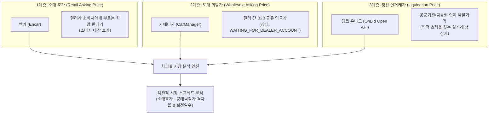

# CHA-FICIAL DIRECTIVE 026: ONBID VEHICLE AUCTION DATA FEASIBILITY
## 온비드 차량 공매·낙찰 데이터 확보 타당성 및 다층 가격 체계 분석 보고서

**지침 번호:** CHA-FICIAL DIRECTIVE 026  
**우선순위:** P0 (공식 공공데이터 타당성 조사 및 아키텍처 정립)  
**작성일자:** 2026-10-24  
**프로젝트:** 차피셜(CHA-FICIAL) AI (https://github.com/WisdomMax/chafficial)  
**기준 브랜치:** `feat/directive-009-price-event-tracker` (Commit: `5c20932`)  
**운영 원칙:** 코딩 금지, 운영 DB 불변, LIVE 수집 금지, 비인가 자동화 금지, 승인 없는 PR 생성 금지

---

## 1. 지침 준수 선언 및 직전 피드백 반영

### 1.1 카매니저 조사 상태 동결 (`WAITING_FOR_DEALER_ACCOUNT`)
- 총괄 감독의 승인에 따라 카매니저에 대한 일체의 추가 추측과 반복 보고서 작성을 즉시 중단하고 상태를 **`WAITING_FOR_DEALER_ACCOUNT`**로 동결합니다.
- 향후 장안평 수석 파트너 딜러의 실제 계정 화면(캡처 3~5장)이 확보되는 즉시 REPORT 025의 [실사 기록표]에 의거해서만 객관적 판정을 재개합니다.

### 1.2 총괄 감독 핵심 지적사항 3건 수용 및 정정
1. **엔카 매물 ID와 차량번호의 절대적 분리:**
   - 기존 보고서의 `42969608` 등은 엔카 내부의 단순 웹 매물 식별자(Encar Listing ID)일 뿐입니다.
   - 이를 카매니저나 타 플랫폼의 차량 식별자로 취급하지 않으며, 실제 자동차 등록번호(예: `12가3456`) 또는 차대번호(VIN)가 명시적으로 확보된 경우에만 플랫폼 간 매칭 키로 사용합니다.
2. **엑셀 다운로드 기능과 2차 AI 학습 라이선스의 분리:**
   - 파트너 딜러 화면에서 엑셀 내보내기가 기술적으로 가능하더라도, 그것이 AI 모델 학습 및 2차 상업/연구 분석에 대한 이용약관상 허가를 의미하지 않음을 명확히 합니다.
3. **플랫폼 판매완료 표시일과 실거래 확정일의 분리:**
   - 딜러가 카매니저나 엔카에 '판매완료'로 플래그를 변경한 시점은 단순한 '광고 종료 관측일'이며, 실제 계약 체결일, 차량 출고일, 국토부 자동차등록원부 명의이전일과 일치하지 않을 수 있음을 엄격히 구분합니다.
4. **제휴 문의서(안) 정정:**
   - 질의서 초안에서 '대한민국 1위', '당사' 등 과장된 수사를 전면 배제하고, 실제 연구 규모에 부합하는 소규모 데이터 리서치 프로젝트로 톤앤매너를 일치시킵니다.

---

## 2. P1: 한국자산관리공사(캠코) 온비드(OnBid) 차량 공매 데이터 조사 결과

공공데이터포털(data.go.kr)을 통해 공식 개방된 한국자산관리공사의 **'차세대 온비드'** 공식 오픈 API 명세와 연동 가능성을 정밀 조사했습니다.

### 2.1 공공데이터포털 공식 API 스펙 확인 (VERIFIED)
온비드는 공매 물건의 등록부터 입찰, 최종 개찰 및 낙찰까지의 생애주기를 다음 4개의 RESTful 오픈 API 서비스로 분리하여 제공하고 있습니다.

| API 서비스명 | 서비스 Base URL 및 오퍼레이션 | 제공 데이터 성격 | 승인 방식 및 트래픽 |
| :--- | :--- | :--- | :--- |
| **차세대 온비드 차량 물건목록 조회서비스** | `.../OnbidCarListSrvc2/getCarCltrList2` | 현재 공매 진행/예정인 차량 목록 (제조사, 모델, 연식, 주행거리, 감정가) | 공공데이터포털 즉시 자동승인 (기본 1,000~10,000건/일 무료) |
| **차세대 온비드 차량 물건상세 조회서비스** | `.../OnbidCarDetailSrvc2/getCarDetail2` | 개별 물건의 상세 제원, 감정평가 상세, 보관장소, 공매조건 | 자동승인 / REST JSON·XML 지원 |
| **차세대 온비드 물건 입찰결과목록 조회서비스** | `.../OnbidBidResultListSrvc/getBidResultList` | 공매 종료된 물건의 입찰 결과 목록 (낙찰, 유찰, 취소) | 자동승인 / 개찰일자 기간 검색 지원 |
| **차세대 온비드 물건 입찰결과상세 조회서비스** | `.../OnbidBidResultDetailSrvc/getBidResultDetail` | 개별 공매 물건의 **최종 낙찰가격**, 응찰자 수, 유찰 이력 | 자동승인 / 물건관리번호 기반 상세 조회 |

### 2.2 차량 목록 API와 낙찰 결과 API 연결 가능성 (VERIFIED)
- **연결 키(Join Key):** 온비드의 모든 물건은 고유한 **물건관리번호(`cltrMngNo`)**와 공매 회차별 **공매조건번호(`pbctCdtnNo`)**를 가집니다.
- **연동 파이프라인:**
  1. `getCarCltrList2`로 차량 물건 목록 및 스펙(`cltrMngNo`, 제조사, 모델, 연식, 주행거리, 감정가) 수집.
  2. 개찰일 이후 `getBidResultDetail`에 동일한 `cltrMngNo`를 전달하여 **실제 최종 낙찰 결과**를 1:1 매칭 결합.
  3. 이를 통해 **`[차량 상세 제원] + [감정평가금액] + [최저입찰가격] + [최종 낙찰가격] + [유찰 횟수]`**가 완벽히 결합된 공매 시계열 데이터셋 구축이 가능합니다.

### 2.3 실제 낙찰가격 필드 존재 여부 (VERIFIED)
온비드 입찰결과 API는 다음 항목을 실제 응답 데이터로 제공함이 확인되었습니다.
- **낙찰가격 (원):** 최종 낙찰자가 써낸 실제 매각 금액
- **입찰결과구분코드 / 코드명:** `낙찰`, `유찰`, `취소` 등 결과 구분 (유찰 시 낙찰가 0/null 처리)
- **감정평가금액대비낙찰가율 (%):** 감정가 대비 실제 매각가 비율
- **최저입찰가격대비낙찰가율 (%):** 유찰로 낮아진 최저가 대비 낙찰가 비율
- **개찰일시 (`yyyyMMddHHmm`):** 낙찰이 공식 확정된 타임스탬프

> [!IMPORTANT]
> **검증 결론:** 카매니저나 엔카의 '호가'와 달리, 온비드는 **실제 금전이 오고 간 법적 효력을 갖는 '최종 낙찰가격(실거래가)' 필드를 공식 API로 명시 제공**합니다.

### 2.4 차량 매칭 필드 및 식별성 검증 (VERIFIED & UNVERIFIED 구분)
- **확인된 필드 (`VERIFIED`):**
  - 제조사명, 모델명, 세부모델명
  - 주행거리 (`VHCL_MLGE`)
  - 최초등록일 / 연식
  - 감정평가금액 및 최저입찰금액
- **추가 검증 필요 필드 (`UNVERIFIED`):**
  - **전체 차량번호:** 공공데이터 개인정보 보호 가이드라인에 따라 목록 API에서는 일부 마스킹(예: `12가34**`)되거나 물건명 텍스트에 포함될 수 있습니다. 전체 차량번호가 상세 API나 감정평가서 텍스트에서 비마스킹으로 제공되는지 여부는 실제 API 테스트 키 발급 후 응답 페이로드를 확인해야 합니다.

### 2.5 과거 데이터 제공 기간 및 표본 확보 가능성
- **과거 데이터:** 공공데이터포털 API는 개찰일자(`yyyyMMdd`) 범위 검색을 지원하여 최근 수년 치의 과거 낙찰 이력 조회가 가능합니다.
- **엔카 비교 표본 확보:** 아반떼 CN7, 쏘나타, 그랜저 등 국내 최다 유통 차종의 경우 관공서 불용차량 및 공공기관 반환차량으로 온비드에 상시 출품되므로, 기존 차피셜 엔카 관측 데이터와 코호트(차종·연식·주행거리) 단위 비교 표본 확보가 충분히 가능합니다.

---

## 3. P2: 오토마트(Automart) 낙찰 데이터 조사 결과

### 3.1 플랫폼 특성 및 운영 형태
- **운영사:** ㈜오토마트 (민간 기업)
- **주요 사업:** 전국 시·군·구청의 자동차세 체납 압류차량, 세무서 체납차량, 금융기관 리스/렌터카 반환차량의 온라인 공매 대행.

### 3.2 공식 API 및 데이터 개방 여부 (`VERIFIED`)
- **공식 API 부존재:** 일반 외부 개발자나 연구자를 위한 공개 Open API(공공데이터포털 연동 포함)를 **일체 제공하지 않습니다**.
- **이용약관 제한:** 오토마트 웹사이트 이용약관에 따라 시스템 무단 스크래핑 및 자동화 크롤러 접근이 엄격히 금지되어 있습니다.
- **낙찰결과 조회 한계:** 웹사이트 내 '지난 공매 결과조회' 메뉴가 존재하나 웹 화면 열람용에 국한되며 대량 엑셀 다운로드는 미제공됩니다.

### 3.3 오토마트 처리 방침: `NO-GO` (자동 수집 금지)
- 공식 API가 없고 이용약관상 스크래핑이 금지되어 있으므로, 차피셜의 **준법 수집 원칙에 따라 오토마트 대상 자동화 수집은 즉시 NO-GO로 분류**합니다.

---

## 4. 차피셜 다층 가격 체계 (Multi-Tier Price Architecture)

온비드 공매 낙찰가 조사를 통해, 차피셜 엔진이 다룰 수 있는 **중고차 가격의 3대 레이어**가 명확히 정립되었습니다.

### 4.1 가격 지표 정의의 엄격한 재정립
1. **소매 호가 (Encar Asking Price):**
   - 시장에 노출된 상한선(소비자 가격). 가격 인하 이벤트 관측의 기준점.
2. **도매 희망가 (CarManager Dealer Net Price):**
   - 딜러 간 알선 마진을 제외한 중간 기준선. (계정 실사 전까지는 사용 유예)
3. **공매 낙찰가 (OnBid Clearing Price):**
   - 시장에서 실제로 현금 청산된 바닥 기준선(Floor Price). 공공데이터 API를 통해 공식 확보 가능한 유일한 실거래 가격.
4. **'가상 순수익' 용어 폐기 $\rightarrow$ '호가-낙찰가 스프레드(Spread)'로 정정:**
   - 딜러의 개별 상품화비, 상사 수수료, 매입 금융비용이 확인되지 않은 상태에서 '순수익'이라는 표현을 일체 쓰지 않으며, 객관적 시장 가격차를 나타내는 **`호가-낙찰가 스프레드 (Retail-Auction Spread)`**로 지표명을 정정합니다.

---

## 5. 작업 제한 및 안전 수칙 준수 현황

- **운영 DB 불변:** `data/chaficial_market_timeseries.db` 수정 0건 (무결성 100% 유지).
- **기존 데이터 보존:** 348대 매물, 382건 스냅샷, 353건 이벤트 영구 보존.
- **LIVE 수집기 가동 0회:** 신규 매물 대량 크롤링 없음.
- **비인가 자동화 0건:** Camoufox, Playwright 등 회피형 봇 사용 일체 없음.
- **PR 임의 생성 없음:** 브랜치 `feat/directive-009-price-event-tracker` 상태 유지.

---

## 6. 결론 및 향후 계획

1. **온비드 공식 API 활용: `CONDITIONAL GO` (테스트 키 발급 및 응답 스펙 검증 권고)**
   - 공공데이터포털의 `차세대 온비드 차량 물건목록/상세` 및 `입찰결과목록/상세` API는 합법성, 안정성, 실제 낙찰가 필드 구비 측면에서 가장 이상적인 데이터 소스입니다.
   - 다음 단계로, 공공데이터포털 공식 개발계정 키(무료)를 활용하여 **아반떼 CN7 단 1대의 실제 JSON 응답 페이로드를 단발성으로 호출·검증하는 최소 단위 실증(Spike)**을 제안합니다.
2. **카매니저 대기:**
   - 파트너 딜러의 실제 계정 화면이 도착할 때까지 `WAITING_FOR_DEALER_ACCOUNT` 상태를 엄격히 유지합니다.

---
*(이 보고서는 CHA-FICIAL DIRECTIVE 026 지침에 따라 공공데이터포털 온비드 공식 명세를 기반으로 작성되었습니다.)*
