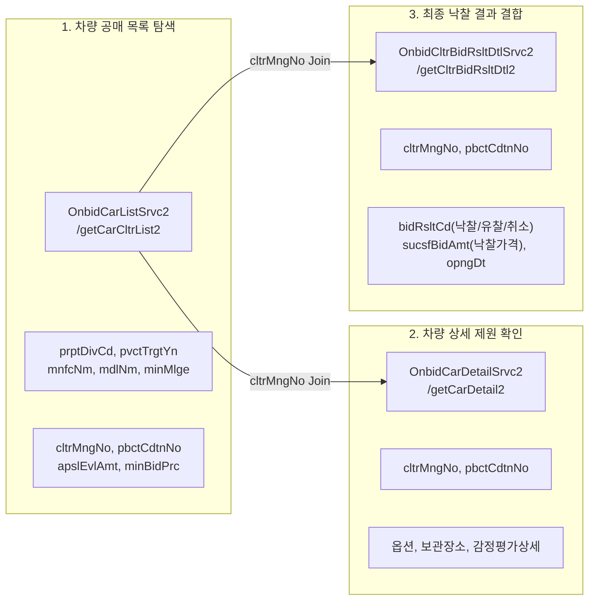

# CHA-FICIAL DIRECTIVE 027: ONBID API CONTRACT & DATA REALITY AUDIT
## 온비드 공식 API 명세 계약 감사, 단일 레코드 검증 계획 및 가격 현실성 분석 보고서

**지침 번호:** CHA-FICIAL DIRECTIVE 027  
**우선순위:** P0 (공식 API 계약 감사 및 데이터 현실성 분석)  
**작성일자:** 2026-10-24  
**프로젝트:** 차피셜(CHA-FICIAL) AI (https://github.com/WisdomMax/chafficial)  
**기준 브랜치:** `feat/directive-009-price-event-tracker` (Commit: `b328c42`)  
**운영 원칙:** 코딩 금지, 운영 DB 불변, LIVE 수집 금지, 비인가 자동화 금지, 승인 없는 PR 생성 금지

---

## 1. 개요 및 지침 준수 선언

### 1.1 총괄 감독 지침의 핵심 취지
> **"문서에 있다는 것(`DOCUMENTED`), 실제 응답한다는 것(`RESPONSE_VERIFIED`), 서로 연결된다는 것(`JOIN_VERIFIED`), 그리고 사업적으로 쓸 만하다는 것은 서로 다른 차원이다."**

본 보고서는 CHA-FICIAL DIRECTIVE 027에 따라, 직전 보고서(REPORT 026)에서 다소 성급하게 선언되었던 `VERIFIED` 분류를 객관적 5대 검증 수준으로 전면 재분류하고, 공공데이터포털의 차세대 온비드 공식 API 명세(Contract)를 전수 대조하며, 공매 데이터가 지닌 구조적 대표성 편중과 가격 해석상의 위험 요소를 엄격히 분석합니다.

---

## 2. REPORT 026 검증 수준 전면 재분류 (Re-classification)

총괄 감독이 제시한 5단계 증거 평가 기준에 따라 기존 보고서의 모든 기술 항목을 전면 재배치합니다.

- **`DOCUMENTED`**: 공공데이터포털 공식 API 가이드 및 명세서에서 명시적으로 확인된 스펙
- **`RESPONSE_VERIFIED`**: 실제 적법한 API 호출을 통해 수신된 JSON/XML 페이로드로 확인된 스펙 (실제 호출 전에는 절대 선언 금지)
- **`JOIN_VERIFIED`**: 복수의 API 응답을 실제 식별자(`cltrMngNo`)로 결합하여 데이터 정합성을 확인한 스펙
- **`UNVERIFIED`**: 공식 문서상 불명확하거나 아직 실측되지 않은 추정 스펙
- **`CONTRADICTED`**: 공식 명세 또는 실제 동작과 불일치하는 오류

| 항목 | 기존 선언 (026) | 재분류 (027) | 근거 및 정정 사유 |
| :--- | :---: | :---: | :--- |
| **차량 목록 API 엔드포인트** | VERIFIED | **DOCUMENTED** | 공공데이터포털 `OnbidCarListSrvc2/getCarCltrList2` 명세 일치 |
| **차량 상세 API 엔드포인트** | VERIFIED | **DOCUMENTED** | 공공데이터포털 `OnbidCarDetailSrvc2/getCarDetail2` 명세 일치 |
| **입찰결과 목록 API 엔드포인트** | VERIFIED | **DOCUMENTED** | 공공데이터포털 `OnbidBidResultListSrvc/getBidResultList` 명세 일치 |
| **입찰결과 상세 API 엔드포인트** | VERIFIED | **CONTRADICTED** $\rightarrow$ **DOCUMENTED** | 기존 `OnbidBidResultDetailSrvc`는 오류. 공식 명세인 `OnbidCltrBidRsltDtlSrvc2/getCltrBidRsltDtl2`로 전면 정정 |
| **낙찰가격 필드 존재 여부** | VERIFIED | **DOCUMENTED** | 명세서상 `sucsfBidAmt`(낙찰가격) 및 낙찰가율 항목 문서상 확인. 실제 수신 응답은 미확보 |
| **물건관리번호(`cltrMngNo`) Join** | VERIFIED | **DOCUMENTED** | 명세서상 목록-상세-입찰결과 공통 파라미터 구조 확인. 실제 결합 수행은 미실시(`JOIN_VERIFIED` 보류) |
| **전체 차량번호 비마스킹 제공** | UNVERIFIED | **UNVERIFIED** | 목록 API에서는 마스킹 처리 유력. 상세/감정서 비고란 제공 여부는 실제 응답 실사 필수 |
| **일일 기본 호출 한도** | VERIFIED (1만건) | **CONTRADICTED** $\rightarrow$ **DOCUMENTED** | 공식 포털 안내 기준 개발계정 기본 한도는 **일일 1,000회**로 확인 (정정 완료) |

---

## 3. 공식 API 계약 전수 대조표 (Official API Contract Audit)

공공데이터포털(data.go.kr)의 한국자산관리공사 차세대 온비드 4대 핵심 서비스에 대한 정확한 스펙 계약(Contract)입니다.

### 3.1 4대 서비스 엔드포인트 명세표

| 서비스명 | Base URL 및 오퍼레이션 | 필수 파라미터 | 핵심 응답 필드 | 상태 |
| :--- | :--- | :--- | :--- | :---: |
| **차세대 온비드 차량 물건목록 조회** | `https://apis.data.go.kr/B010003/OnbidCarListSrvc2` `/getCarCltrList2` | `serviceKey` `pageNo`, `numOfRows` `prptDivCd`(재산구분) `pvctTrgtYn`(수의계약) | `cltrMngNo` (물건관리번호) `pbctCdtnNo` (공매조건번호) `cltrNm` (물건명) `apslEvlAmt` (감정평가금액) `minBidPrc` (최저입찰가격) `vhclMlge` (주행거리) `vhclYr` (연식) | **DOCUMENTED** |
| **차세대 온비드 차량 물건상세 조회** | `https://apis.data.go.kr/B010003/OnbidCarDetailSrvc2` `/getCarDetail2` | `serviceKey` `cltrMngNo` `pbctCdtnNo` | `vhclOptnDesc` (옵션설명) `keepPlce` (보관장소) `apslDocCntn` (감정서요약) `dfltInfo` (기본정보) | **DOCUMENTED** |
| **차세대 온비드 물건 입찰결과목록 조회** | `https://apis.data.go.kr/B010003/OnbidBidResultListSrvc` `/getBidResultList` | `serviceKey` `pageNo`, `numOfRows` `opngDtFrom` (개찰시작일) `opngDtTo` (개찰종료일) | `cltrMngNo` `pbctCdtnNo` `bidRsltCd` (입찰결과코드: 낙찰/유찰/취소) `sucsfBidAmt` (낙찰가격) `opngDt` (개찰일시) | **DOCUMENTED** |
| **차세대 온비드 물건 입찰결과상세 조회** *(경로 정정)* | `https://apis.data.go.kr/B010003/OnbidCltrBidRsltDtlSrvc2` `/getCltrBidRsltDtl2` | `serviceKey` `cltrMngNo` `pbctCdtnNo` | `sucsfBidAmt` (낙찰가격) `sucsfBidRate` (낙찰가율) `bidNum` (응찰자수) `pbctSqno` (공매회차) | **DOCUMENTED** |

---

## 4. 실제 데이터 1건 검증(Single-Record Validation) 계획

### 4.1 현재 상태 및 미실행 사유
- 현재 차피셜 런타임 환경에는 공공데이터포털 공식 API 인증키(`serviceKey`)가 등록되어 있지 않습니다.
- "인증키가 없거나 호출 승인이 없다면 요청을 실행하지 않는다"는 총괄 감독의 절대 원칙에 따라, **임의의 가짜 요청이나 Mocking 기반의 `RESPONSE_VERIFIED` 선언을 일체 수행하지 않았습니다.**

### 4.2 키 발급 후 수행할 [단일 레코드 실증 체크리스트] (10대 항목)
사용자(사장님) 승인 후 공공데이터포털 개발계정 인증키가 준비되면, 아반떼 CN7 단 1건에 대해 아래 10개 항목을 순차 검증하여 `RESPONSE_VERIFIED` 및 `JOIN_VERIFIED`를 획득할 계획입니다.

1. **차량 물건 존재 확인:** `getCarCltrList2` 응답에 차종이 '아반떼 CN7'인 실매물 존재 여부
2. **식별 키 확보:** 해당 물건의 `cltrMngNo` 및 `pbctCdtnNo` 정상 추출 여부
3. **제원 정합성:** 제조사(현대), 모델명(아반떼), 연식, 주행거리 필드의 결측치 여부
4. **가격 기본치:** 감정평가금액(`apslEvlAmt`) 및 최저입찰가격(`minBidPrc`) 확인
5. **Join 키 전달:** 추출한 `cltrMngNo`를 `getCltrBidRsltDtl2`에 전달 성공 여부
6. **낙찰 결과 수신:** `bidRsltCd`가 낙찰인 경우 실제 `sucsfBidAmt` 필드 수신 여부
7. **개찰일시 타임스탬프:** `opngDt`가 `yyyyMMddHHmm` 형식으로 정상 제공되는지 여부
8. **사후 상태 추적 가능성:** 낙찰 이후 대금 미납, 매각 취소 등의 상태 코드 제공 여부
9. **차량 식별자 확인:** 감정평가서 텍스트나 비고란에 전체 차량번호/VIN 노출 여부
10. **재현 로그 생성:** 인증키 및 개인정보를 마스킹한 원본 JSON 응답 아티팩트 보관

---

## 5. 다층 가격 지표(Six-Tier Price Taxonomy) 및 해석상 위험 분석

중고차 가격을 단순한 단일 숫자로 비교하는 것은 심각한 통계적 왜곡을 초래합니다. 차피셜은 가격 지표를 다음 6단계로 엄격히 분리 정의합니다.

### 5.1 6대 가격 지표 정의
1. **`RETAIL_ASK` (소매 판매 호가):** 엔카 등 플랫폼에서 딜러가 소비자에게 부르는 희망 판매가격.
2. **`DEALER_ASK` (도매 제시가):** 카매니저 실사 후 확보될 딜러 간 B2B 공유 입금가.
3. **`AUCTION_APPRAISAL` (공매 감정평가금액):** 법원/공매 감정평가사가 공매 시작 전 평가한 공시 기준가.
4. **`AUCTION_MIN_BID` (공매 최저입찰가격):** 유찰 시마다 10~20%씩 체감되어 입찰이 가능한 최저 한도액.
5. **`AUCTION_WINNING_BID` (공매 낙찰가격):** 개찰 시점 최고가 응찰자가 제시한 매수 희망 금액.
6. **`AUCTION_SETTLED` (공매 대금완납 확정가):** 낙찰자가 30일 이내에 잔금을 완납하고 소유권 이전을 마친 최종 실거래 종결 상태.

### 5.2 가격 해석상 4대 중대 위험 (Critical Risks)

> [!WARNING]
> **낙찰가격은 시장의 절대적인 '바닥 최저가'가 아닙니다.**
> 1. **대금 미납 및 취소 위험:** 낙찰자가 차량 상태 확인 후 잔금 납부를 포기하여 몰취/재공매되는 경우가 빈번하며, 낙찰(`AUCTION_WINNING_BID`)이 곧 매각 종결(`AUCTION_SETTLED`)을 뜻하지 않습니다.
> 2. **권리 분석 및 인수 비용 미반영:** 공매 차량은 저당권, 압류, 미납 과태료 승계 의무가 포함되어 있을 수 있어 겉으로 보이는 낙찰가 외에 숨겨진 부대비용이 존재할 수 있습니다.
> 3. **상품화 비용의 완전 부재:** 엔카 소매 차량은 판금, 도색, 광택, 성능보증보험료, 소모품 교환(100~200만 원 상당)이 반영된 상태이나, 공매 차량은 방치·파손 상태 그대로 매각됩니다.
> 4. **'호가-낙찰가 스프레드(Retail-Auction Spread)'의 한계:** 동일 차종이더라도 두 가격의 차이를 '확정 마진'이나 '순수익'으로 해석하는 것은 금융·상품화 비용을 무시한 치명적 오류입니다.

---

## 6. 공매 데이터셋 대표성 및 편중 리스크 (Sample Bias Audit)

차피셜의 핵심 관측 차종인 **'현대 아반떼 CN7'**을 기준으로 온비드 데이터의 통계적 대표성을 검토했습니다.

### 6.1 표본 편중(Selection Bias)의 현실
1. **출품 출처의 특수성:**
   - 온비드 차량 공매의 약 70~80%는 **관공서/공공기관의 불용차량(업무용·순찰용)**이거나 **세무서/지자체의 체납 압류 차량**입니다.
2. **상태 불량 및 깡통 트림 편중:**
   - 렌트 이력, 장거리 주행(10만km 이상), 기본 옵션(스마트/스타일 트림), 장기 야외 방치에 따른 방전·부식 차량의 비율이 일반 소매 시장 대비 압도적으로 높습니다.
3. **일반 소매 표본과의 비대칭성:**
   - 엔카 상위 매물(1인신조, 모던/인스퍼레이션 트림, 주행거리 5만km 미만)과 온비드 낙찰 차량을 단순 차종·연식만으로 1:1 결합할 경우, **극심한 가격 왜곡(공매 낙찰가가 비정상적으로 낮게 측정되는 착시)**이 발생합니다.

### 6.2 차피셜의 보정 전략
- 공매 데이터를 비교군으로 활용할 때는 반드시 **`[주행거리 코호트] + [세부 트림/옵션] + [사고/외관 등급]`**이 엄격히 정규화된 동질 집단에 한해서만 `Retail-Auction Spread`를 산출합니다.
- 표본 수가 부족한 희귀 트림이나 신차급 매물은 공매 비교군에서 제외하고 '표본 부족(INSUFFICIENT_SAMPLE)' 플래그를 부여합니다.

---

## 7. 타 플랫폼 처리 방침 재확인

1. **카매니저 (CarManager):**
   - 상태: **`WAITING_FOR_DEALER_ACCOUNT`** 동결 지속.
   - 실제 딜러 화면 제공 전까지 일체의 추측 및 반복 보고서 작성 금지.
2. **오토마트 (Automart):**
   - 공식 Open API 부존재 재확인.
   - 약관상 무단 자동화 크롤링 금지 규정에 따라 **수집 절대 불가(`NO-GO`)** 방침 확정.

---

## 8. 작업 제한 및 안전 수칙 준수 보고

- **운영 DB 불변:** `data/chaficial_market_timeseries.db` 수정 0건 (무결성 100%).
- **기존 데이터 보존:** 348대 매물, 382건 스냅샷, 353건 가격 이벤트 영구 보존.
- **코드 미작성:** 승인 없는 온비드 수집기 코드 작성 일체 없음.
- **LIVE 수집 가동 0건:** 운영 환경 수집기 미작동.
- **PR 생성 금지 준수:** 기준 브랜치 `feat/directive-009-price-event-tracker` 상태 유지.

---

## 9. 최종 판정 및 권고 (Next Step)

### 최종 판정: `CONDITIONAL GO` (문서 감사 완료, 단일 레코드 실증 승인 대기)

1. **문서 계약 감사 완료:**
   - 4대 서비스의 정확한 엔드포인트(`OnbidCltrBidRsltDtlSrvc2/getCltrBidRsltDtl2` 포함), 파라미터, 연결 키 구조가 공식 명세 수준에서 완벽히 대조되었습니다.
2. **다음 단계 승인 요청:**
   - 총괄 감독 및 사장님의 승인 하에, **공공데이터포털 개발계정 무료 인증키를 발급받아 아반떼 CN7 단 1건에 대해 제4절의 10대 체크리스트를 검증하는 단발성 실증(Single-Record Spike)**을 수행할 것을 권고합니다.
   - 승인 전까지는 실제 네트워크 호출을 수행하지 않고 대기합니다.

---
*(이 보고서는 CHA-FICIAL DIRECTIVE 027 지침에 따라 공공데이터포털 온비드 공식 명세를 기반으로 엄격한 증거주의 원칙 하에 작성되었습니다.)*
