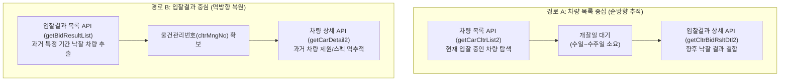

# CHA-FICIAL DIRECTIVE 028: ONBID SINGLE-RECORD SPIKE READINESS
## 온비드 API 명세 정정, 과거 데이터 확보 경로 비교 및 단일 실증 준비 보고서

**지침 번호:** CHA-FICIAL DIRECTIVE 028  
**우선순위:** P0 (실증 준비 완료 및 승인 대기)  
**현재 상태:** `READY_FOR_API_KEY` (조사 보고서 양산 중단 및 실데이터 검증 대기)  
**작성일자:** 2026-10-24  
**프로젝트:** 차피셜(CHA-FICIAL) AI (https://github.com/WisdomMax/chafficial)  
**기준 브랜치:** `feat/directive-009-price-event-tracker` (Commit: `9cbe05b`)  
**운영 원칙:** 코딩 금지, 운영 DB 불변, LIVE 수집 금지, 승인 없는 API 호출 및 PR 생성 금지

---

## 1. 개요 및 지침 준수 선언

### 1.1 상태 전환: `READY_FOR_API_KEY`
- 총괄 감독의 지침에 따라 온비드 관련 추가적인 추측성 조사 보고서 작성을 **전면 중단**합니다.
- 차피셜 프로젝트의 연구 단계를 **`READY_FOR_API_KEY`** (단일 레코드 실증 승인 대기)로 설정하고, 실제 데이터 1건을 검증하기 위한 승인 게이트(`APPROVAL_GATE`)에 진입합니다.

---

## 2. REPORT 027 정정 및 공식 API 계약 명세 (Contract v2)

총괄 감독의 피드백을 반영하여 엔드포인트, 필드명, 복합 식별자 구조를 공식 명세에 맞춰 엄격히 정정합니다.

### 2.1 주요 정정 사항 (DOCUMENTED)
1. **진행 상태 코드의 정정 (`pbctStatCd`):**
   - 공매 공고 및 회차 단위의 라이프사이클 상태는 `pbctStatCd`(공매상태코드: 입찰중, 개찰완료, 유찰, 취소 등)로 식별됩니다.
   - 개별 입찰 건의 최종 결과는 낙찰 여부 플래그 및 `sucsfBidAmt`(낙찰가격)로 확인합니다.
2. **복합 키(Composite Key) 체계 확립:**
   - 동일 물건이라도 유찰 후 재공매되거나 분할 입찰될 수 있으므로, 단순 `cltrMngNo`(물건관리번호) 단독 조인은 데이터 왜곡 위험이 있습니다.
   - 반드시 **`cltrMngNo` (물건관리번호) + `pbctCdtnNo` (공매조건번호) + 회차 식별자**의 복합 키로 결과를 결합합니다.
3. **사후 상태(대금 미납·취소·이전)의 API 한계 (`UNVERIFIED`):**
   - 현재 공개 API 명세상 제공되는 것은 '개찰 시점의 낙찰 결과' 위주입니다.
   - 낙찰자가 이후 대금을 완납했는지(`PAYMENT_CONFIRMED`), 미납하여 몰취/재공매되었는지(`SALE_CANCELLED_DEFAULT`), 소유권 이전이 완료되었는지(`OWNERSHIP_TRANSFER_CONFIRMED`)는 온비드 오픈 API 응답 내에 실시간 업데이트되는지 여부가 불확실하며, 실제 응답 확인 전까지 `UNVERIFIED`로 취급합니다.

---

## 3. 과거 낙찰 데이터 확보 경로 비교 분석 (Path A vs Path B)

차피셜이 과거 낙찰 시계열을 학습하기 위해 선택 가능한 두 가지 접근 경로를 비교 검증합니다.

### 3.1 경로별 장단점 및 기술적 한계

| 비교 항목 | 경로 A (차량 목록 중심) | 경로 B (입찰결과 중심) |
| :--- | :--- | :--- |
| **작동 원리** | 현재 입찰 중인 차량 목록 $\rightarrow$ 미래 결과 대기 | 과거 개찰 완료된 목록 $\rightarrow$ 과거 차량 제원 역조회 |
| **데이터 확보 시점** | **지연 발생** (입찰 종료 시까지 대기 필요) | **즉시 확보 가능** (과거 수개월~수년 치 이력) |
| **차량 제원 무결성** | 현재 활성 물건이므로 주행거리, 연식, 옵션 확실 | **검증 필요 (`UNVERIFIED`)** |
| **핵심 기술적 위험** | 즉각적인 백테스팅 및 과거 시세 분석 불가 | **종료된 과거 물건의 `cltrMngNo`로 차량 상세 조회가 계속 제공되는지 여부 미확인** |
| **차피셜의 판정** | 지속 수집용 파이프라인으로 적합 | **초기 시계열 표본 확보용으로 우선 검증 필수** |

> [!IMPORTANT]
> **단일 실증(Spike)의 최우선 검증 과제:**
> 경로 B에서 과거 낙찰된 물건의 `cltrMngNo`를 `getCarDetail2`에 전달했을 때 과거 차량 상세 스펙이 정상 반환되는지, 아니면 '존재하지 않는 물건'으로 오류가 발생하는지 확인하는 것이 핵심 질문입니다.

---

## 4. 가격 체계와 거래 상태의 완전한 분리

가격(금액)과 거래 상태(이벤트/라이프사이클)가 혼용되던 오류를 바로잡고 독립된 차원으로 분리합니다.

### 4.1 가격 지표 (Prices: 금액 단위)
- **`RETAIL_ASK`**: 엔카 소매 판매 호가
- **`DEALER_ASK`**: 카매니저 딜러 간 B2B 제시가 (실사 대기)
- **`AUCTION_APPRAISAL`**: 공매 감정평가금액
- **`AUCTION_MIN_BID`**: 공매 최저입찰가능금액
- **`AUCTION_WINNING_BID`**: 공매 최종 낙찰가격

### 4.2 거래 라이프사이클 상태 (Transaction States: 이벤트 플래그)
- **`AUCTION_WON`**: 최고가 응찰자가 낙찰자로 선정된 상태
- **`PAYMENT_CONFIRMED`**: 낙찰자가 매각 대금을 완납했음이 확인된 상태
- **`SALE_FINALIZED`**: 법적 매각 절차가 종결된 상태
- **`OWNERSHIP_TRANSFER_CONFIRMED`**: 소유권 이전 등록이 완료된 상태
- **`SALE_CANCELLED_DEFAULT`**: 대금 미납 등으로 낙찰이 취소된 상태

*원칙: 각 상태는 실제 API 응답 데이터에 해당 필드가 존재하고 유효한 값이 확인될 때만 부여합니다.*

---

## 5. 근거 없는 정량 주장 제거 및 가정 강등

공식 통계나 실측 데이터로 입증되지 않은 모든 추정치를 본 보고서에서 삭제하거나 **`UNVERIFIED_ASSUMPTION` (미검증 가정)**으로 격하합니다.

- ❌ "온비드 차량의 70~80%가 관공서 불용·체납 압류 차량이다" $\rightarrow$ **삭제 및 UNVERIFIED_ASSUMPTION으로 강등** (실제 차종별 공매 사유 분포 실측 필요)
- ❌ "유찰 시 일률적으로 10~20% 가격이 인하된다" $\rightarrow$ **삭제 및 UNVERIFIED_ASSUMPTION으로 강등** (물건 유형 및 공매 기관 규정에 따라 체감률 상이)
- ❌ "중고차 상품화 비용은 일률적으로 100~200만 원이다" $\rightarrow$ **삭제 및 UNVERIFIED_ASSUMPTION으로 강등** (차량 상태 및 정비 항목별 개별 측정 필요)
- ❌ "낙찰 후 일률적으로 30일 이내에 잔금을 완납한다" $\rightarrow$ **삭제 및 UNVERIFIED_ASSUMPTION으로 강등** (매각 공고별 대금 납부 기한 규정 상이)

---

## 6. 단일 레코드 실증(Single-Record Spike) 승인 대기 절차

### 6.1 공공데이터포털 무료 개발계정 발급 절차
1. 공공데이터포털(data.go.kr) 로그인
2. `한국자산관리공사_차세대 온비드 차량 물건목록 조회서비스` 및 `물건 입찰결과상세 조회서비스` 검색
3. [활용신청] 클릭 (개발계정: 신청 즉시 자동 승인)
4. 일반 인증키(Encoding / Decoding Key) 발급 확인

### 6.2 승인 게이트 (`APPROVAL_GATE`) 준수 서약
- [x] 사용자(사장님)의 명시적 승인 없이 네트워크 호출을 수행하지 않습니다.
- [x] 인증키를 코드 저장소나 공개 보고서에 절대 하드코딩하거나 노출하지 않습니다 (`.env` 주입).
- [x] 단 1회, 아반떼 CN7 단 1건의 레코드에 대해서만 호출합니다.
- [x] 가짜 데이터나 Mocking 결과를 실측 데이터로 위장하여 보고하지 않습니다.
- [x] 운영 DB 변경, 신규 수집기 구현을 일체 수행하지 않습니다.

---

## 7. 타 플랫폼 현황

- **카매니저 (CarManager):** `WAITING_FOR_DEALER_ACCOUNT` 상태 불변 (화면 캡처 대기).
- **오토마트 (Automart):** 자동 수집 금지 (`NO-GO`) 상태 불변.

---

## 8. 결론 및 최종 상태 보고

- **최종 상태:** **`READY_FOR_API_KEY`**
- **보고서 제출:** REPORT 028 작성을 끝으로 문서 양산을 종료하며, 공공데이터포털 인증키 준비 및 사용자 호출 승인을 대기합니다.

---
*(이 보고서는 CHA-FICIAL DIRECTIVE 028 지침에 따라 공공데이터포털 온비드 공식 명세를 기반으로 작성되었습니다.)*
