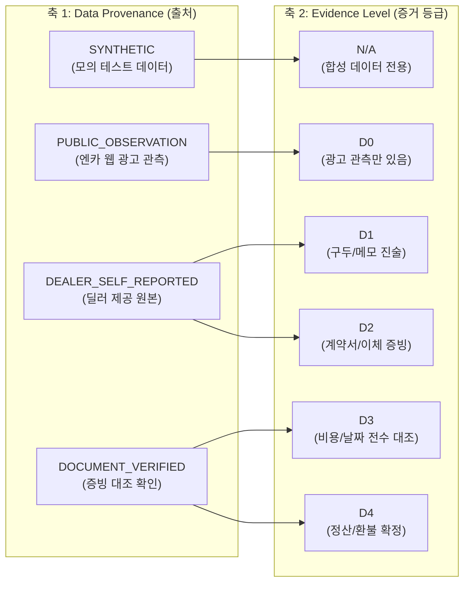

# REPORT 043: FIRST REAL DEALER DATA HANDOFF
## 장안평 제휴 딜러 실제 거래기록 수용 패키지 완비 및 2축 체계 분리 보고서

**지침 번호:** CHA-FICIAL DIRECTIVE 043  
**우선순위:** P0 (실거래 데이터 수용 준비 및 엄격한 출처 관리)  
**작성일자:** 2026-10-26  
**프로젝트:** 차피셜(CHA-FICIAL) AI (`https://github.com/WisdomMax/chafficial`)  
**검증 스크립트:** `scripts/validate_dealer_transactions.py`  
**현재 상태:** **`DEALER_HANDOFF_READY / REAL_DATA_0` (실거래 자료 수령 대기 / 실데이터 0건)**

---

## 1. 데이터 출처(Data Provenance)와 증거 등급(Evidence Level) 2축 분리 완료

총괄 감독관의 설계 지침에 따라 데이터의 출처(생성 주체)와 증거 수준(검증 강도)을 별도 축으로 완전히 분리했습니다.



### 1.1 데이터셋별 2축 분류 확정 현황
| 데이터셋 구분 | 파일 경로 | Data Provenance | Evidence Level | 현재 건수 | 비고 |
| :--- | :--- | :---: | :---: | :---: | :--- |
| **A. 알고리즘 추천 후보** | `data/dealer_pilot/dealer_pilot_8_linked.csv` | `PUBLIC_OBSERVATION` | `D0` | 8건 | 관측 광고 이력 보존, 실거래 미확인 |
| **B. 수식 검증용 합성 데이터** | `data/dealer_pilot/synthetic_test_transactions.csv` | `SYNTHETIC` | **`N/A`** | 5건 | **실거래 등급 부여 원천 차단** |
| **C. 실제 딜러 거래기록** | `data/dealer_pilot/dealer_real_transactions.csv` | `DEALER_SELF_REPORTED` | 미확인 | **0건** | **`REAL_DATA_0` (순수 대기)** |

---

## 2. 딜러용 최소 Excel 입력 양식 구축 (`차피셜_딜러_실거래_입력양식_v1.xlsx`)

제휴 딜러가 복잡한 툴 없이 엑셀로 기입할 수 있도록 2개 시트 구조의 공식 템플릿을 완성했습니다.
- **파일 경로:** `data/dealer_pilot/차피셜_딜러_실거래_입력양식_v1.xlsx`
- **파일 크기:** 8,020 bytes / **SHA-256:** `3a58dd76a5c2e5414d7c0410ff2d1264b38bf228be0bcbf1ee8fc0b8efcf813a`

### 2.1 시트 1: 거래기록 입력
- **필수 항목:** 차량관리번호, 차종/트림, 연식, 주행거리, 매입일, 매입금액
- **거래/비용 항목:** 입고일, 판매일, 판매금액, 취득비용, 상품화비용, 기타비용
- **상태 관리:** 거래상태(판매완료/보유중/취소), 비용정산(완료/미완료), 증빙확인(가능/불가능)

### 2.2 시트 2: 작성 안내 (주요 원칙)
1. **금액 원칙:** 모든 금액은 원 단위로 기입하며, 모르는 금액은 0원이 아닌 **반드시 공란(빈칸)**으로 유지.
2. **비용 원칙:** 발생하지 않은 비용만 명시적으로 0원 입력.
3. **미판매 원칙:** 현재 상사 보유 차량은 판매일/판매금액을 공란으로 남김.
4. **개인정보 차단:** 고객 성명, 연락처, 실제 차량번호, 17자리 차대번호 절대 기입 금지.
5. **증빙 원칙:** 계약서 첨부는 필수가 아니며, 상사 장부/정산 메모 기반 기입 허용.

---

## 3. 딜러 자료 요청 안내문 (`reports/pilot/dealer_intake_guide.md`)

장안평 차마트 대표님 및 딜러 파트너에게 즉시 전달할 수 있는 1페이지 공식 협조 안내문을 독립 문서로 작성 완료했습니다.
- **핵심 메시지:** 최근 거래 차량 5~10대 표본 요청, 생존 편향 방지를 위한 다양한 표본(완판/장기보유/수리비과다/취소) 요청, 개인정보 절대 미수집 확약, 차피셜 연구 목적 외 외부 유출 방지 서약.

---

## 4. 검증 엔진 실행 로그 (100% PASS)

```text
[*] DIRECTIVE 043: 딜러 실거래 2축 체계 및 양식 검증기 실행...
[+] 1. CSV 템플릿 검증: 3행 유효 (오류: 0건)
[+] 2. Excel(.xlsx) 템플릿 구조 검증: 정상 로드 완료 (SHA-256: 3a58dd76a5c2e541...)
[+] 3. 격리된 합성 데이터(SYNTHETIC) 검증: 5행 유효 (전수 evidence_level='N/A': True)
[+] 4. 실제 딜러 거래기록(dealer_real_transactions.csv):
   -> [STATUS: DEALER_HANDOFF_READY / REAL_DATA_0] 실거래 원본 인입 대기 중 (등록 0건, 순수 대기)
[+] 5. 추천 후보 8대 2축 분리 검증: PUBLIC_OBSERVATION (True), D0 (True)

--- [DIRECTIVE 043 검증 최종 결론] ---
1. 2축 체계 분리 확립: Data Provenance (출처 5종) vs Evidence Level (D0~D4, N/A)
2. 합성 데이터 규격화: SYNTHETIC 데이터는 evidence_level='N/A'로 완전 격리
3. Excel 템플릿 완비: data/dealer_pilot/차피셜_딜러_실거래_입력양식_v1.xlsx (2개 시트)
4. 현재 실거래 상태: DEALER_HANDOFF_READY / REAL_DATA_0 (추정/모의 데이터 진입 원천 차단)
--------------------------------------
```

---

## 5. 결론 및 향후 실거래 파일럿 진입 조건

1. **핸드오프 패키지 완비**:
   - `차피셜_딜러_실거래_입력양식_v1.xlsx` (Excel 양식 및 작성 가이드)
   - `dealer_intake_guide.md` (딜러 협조 요청문)
   - `validate_dealer_transactions.py` (2축 검증 및 Excel 호환 엔진)
2. **현재 공식 상태**:
   - **`DEALER_HANDOFF_READY / REAL_DATA_0`**
   - 실제 딜러 거래기록은 현재 0건이며, 어떠한 합성 데이터나 자의적 추정도 실거래로 등록되지 않았습니다.
3. **첫 실거래 분석의 진입 조건 (FROZEN UNTIL DATA ARRIVES)**:
   - 제휴 딜러로부터 실제 엑셀 파일(5~10건)이 접수되고 출처 및 메타데이터가 확인될 때까지, **수익성 성과 선언, 추천 점수와 수익의 상관관계 분석, 강화학습 모델 업데이트를 전면 중단**하고 순수 대기 상태를 유지합니다.

**보고자:** 제미나이 (Antigravity 엔지니어)  
**상태:** DIRECTIVE 043 완수 / `DEALER_HANDOFF_READY / REAL_DATA_0` 확정
