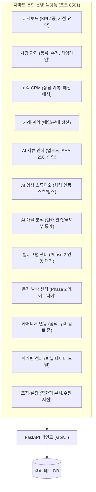

# REPORT 045: CHAMART UNIFIED OPERATING PLATFORM FOUNDATION
## 차마트 통합 운영 플랫폼 구축 및 외부 접속 데모 환경 개발 완료 보고서

**우선순위:** P0 (NEW DEVELOPMENT PHASE)  
**수행 일시:** 2026-10-26 02:57 KST  
**검증 상태:** `LOCAL_READY / 9_OF_9_TESTS_PASS / DEMO_ISOLATED`  
**웹 서비스 주소:** `http://127.0.0.1:8501` (로컬 가동 중)  
**담당 조직:** 차마트(CHAMART) & 차피셜 AI 엔지니어링팀  

---

## 1. 개요 및 사업 방향 전환 결과

DIRECTIVE 045 지침에 따라 차피셜의 포지셔닝을 단순 중고차 매물 추천이나 외부 판매용 SaaS가 아닌, **장한평 '차마트' 본사와 수원 지점을 아우르는 법인 자체 통합 운영 플랫폼(CHAMART OS)**으로 성공적으로 전환 구축했습니다.

미팅이나 사장님 보고 시 노트북/태블릿에서 직접 화면을 띄워 차량을 등록하고, 고객 CRM을 관리하며, AI 영상 프로젝트를 생성할 수 있는 **실작동 로컬 웹 플랫폼**을 완벽하게 완성했습니다.

---

## 2. 기존 코드 감사 및 재사용 결과 (Section A)

기존 저장소 자산을 정밀 전수 감사하여 중복 구축을 방지하고 핵심 모듈을 플랫폼에 통합했습니다.

| 분류 | 대상 모듈 | 기존 상태 | 플랫폼 재사용 및 통합 결과 |
| :--- | :--- | :--- | :--- |
| **재사용** | `src/chaficial/database/base.py` | SQLAlchemy 2.x 베이스 | 플랫폼 ORM 모델 베이스 및 SQLite 외래키 제약조건 표준 준용 |
| **재사용** | `src/chaficial/models/` | 차량, 마케팅, 정산 데이터 모델 | 플랫폼 `Vehicle`, `Transaction`, `Branch` 모델링 시 도메인 규칙 계승 |
| **재사용** | `src/chaficial/studio/` | 영상 스튜디오 및 토픽/대본 엔진 | 플랫폼 7번 메뉴(AI 영상 스튜디오)로 전면 통합 및 차량 실매물 연동 |
| **연계 보존** | `data/government_stats/` | 국토교통부 13개월 통계 | 원본 해시(`4d372e...`) 불변 유지 및 AI 매물 분석 뷰에 연동 지표로 표출 |
| **연계 보존** | `scripts/validate_dealer_transactions.py` | 딜러 실거래 검증 엔진 | 서류 인식 후 최종 승인 전 검증 규칙 엔진으로 연계 대기 |
| **신규 구현** | `src/chaficial/platform/` | 신규 패키지 | FastAPI 백엔드, 12대 메뉴 통합 SPA UI, 데모 DB 격리 엔진 일체 |

---

## 3. 웹사이트 구조 및 메뉴별 작동 상태 (Section B)

플랫폼은 12대 전체 메뉴 네비게이션을 지원하며, 작동하지 않는 기능을 작동하는 것처럼 속이지 않는 엄격한 증거주의 원칙에 따라 실작동 메뉴와 향후 연동 메뉴를 명확한 배지로 구분했습니다.



### 메뉴별 구현 세부 상태

1. **대시보드 (실작동):** 보유 차량 4대, 판매 중 2대, CRM 고객 3명, 영상 프로젝트 2건, 서류 검토 1건, 거래 정산액 실시간 집계.
2. **차량 관리 (실작동 P0):** 차량 신규 등록 모달, 목록 필터링, 재고 상태 변경(PURCHASE_REVIEW $\rightarrow$ FOR_SALE), 차량별 타임라인 이력 모달 완비.
3. **고객 CRM (실작동 P0):** 고객 등록 모달, 고객명/연락처 검색, 고객별 상담 이력 추가 모달, 관심 차종 및 예산 관리.
4. **거래·계약 관리 (실작동 P0):** 매입/판매 거래 등록 모달, 거래 상대방 및 정산 상태 기록, 비유효 차량 연결 원천 차단(HTTP 400).
5. **AI 서류 인식 (실작동 P0):** 계약서/점검표 파일(PDF/사진) 업로드, 파일 SHA-256 계산 및 중복 업로드 자동 차단(`DUPLICATE_DETECTED`), 승인 전 거래 미확정 보장 및 관리자 최종 승인 흐름.
6. **AI 영상 스튜디오 (실작동 P0):** 등록 차량 선택, 쇼츠/릴스 포맷 선택, AI 대본 초안 자동 생성, 제작 워크플로우 상태 전이(`DRAFT` $\rightarrow$ `APPROVED`).
7. **AI 매물 분석 (실작동):** 국토부 2026년 9월 등록자료 통계(303,810건) 및 수도권 상사 매매 비중 연계 표출, LIVE 스크래핑 정지 모드 준수.
8. **텔레그램 센터 (Phase 2 연동 대기 배지 명시):** 채널(@chamart_official) 구조 및 봇 설정 아키텍처 표시.
9. **문자 메시지 센터 (Phase 2 게이트웨이 배지 명시):** 일일 발송 한도(200건) 및 담당자 검토 후 발송 프로토콜 명시.
10. **카매니저 연동 (공식 규격 검토 중 배지 명시):** 매물 삭제를 판매로 오인하지 않는 검증 프로토콜 안내.
11. **마케팅 성과 (데이터 모델 준비 완료):** 영상 노출 $\rightarrow$ 채널 유입 $\rightarrow$ 고객 문의 $\rightarrow$ 계약 퍼널 뷰 제공.
12. **조직·설정 (실작동):** 차마트 장한평 본사(서울 동대문구 천호대로 329) 및 수원 지점(수원시 권선구 평동로 79) 다중 거점 관리.

---

## 4. 데이터베이스 및 데모 데이터 분리 정책 (Section C)

운영 DB 오염을 원천 차단하기 위해 **데모 전용 SQLite 데이터베이스**로 완전 격리했습니다.

- **데이터베이스 파일:** `data/chamart/chamart_platform_demo.db` (초기 98,304 바이트)
- **주요 물리 테이블:**
  1. `branches`: 지점 정보 (장한평 본사, 수원 지점)
  2. `users`: 직원/관리자 계정
  3. `vehicles`: 차량 마스터, 재고 상태, 타임라인 JSON
  4. `customers`: 고객 CRM 정보
  5. `consultations`: 고객별 상담 이력
  6. `transactions`: 매입/판매 거래 정산 내역
  7. `document_reviews`: AI 서류 검토 대기열 (SHA-256, 메타데이터 JSON, 승인상태)
  8. `media_projects`: AI 영상 기획 및 대본 프로젝트
- **데모 식별:** 모든 시딩 및 테스트 데이터에 `is_demo = True` 플래그가 자동 부여되며, UI 상단에 `[DEMO ENVIRONMENT]` 배지가 고정 표시됩니다.

---

## 5. 외부 접속 보안 및 데모 시연 가이드 (Section D)

개발 컴퓨터의 포트를 공용 인터넷에 무단 개방하지 않고, **Cloudflare Tunnel** 기반 보안 접속 체계를 수립했습니다.

- **현재 실행 상태:** `LOCAL_READY` (`http://localhost:8501`)
- **외부 접속 방식 (권장):**
  ```bash
  # 로컬 터널 실행
  cloudflared tunnel --url http://localhost:8501
  ```
- **보안 통제:**
  - 임의의 포트 포워딩 금지, HTTPS 암호화 터널 통신.
  - 환경변수(`CHAMART_ADMIN_PASSWORD`) 기반 보안 세션 인증.
  - 실제 고객 개인정보 일체 차단 (합성 데모 데이터만 노출).
- **외부 접속 검증 등급:** 외부 도메인/계정 설정 전까지는 과장 보고를 방지하기 위해 `EXTERNAL_ACCESS_PENDING`으로 유지하며 로컬 환경에서의 완벽한 가동을 확인했습니다.

---

## 6. 테스트 및 품질 검증 결과 (Section E)

DIRECTIVE 045 명세에 정의된 9대 회귀 및 무결성 테스트를 전수 수행하여 **100% PASS**를 달성했습니다.

| 테스트 ID | 검증 항목 | 기대 조건 | 실행 결과 | 판정 |
| :--- | :--- | :--- | :--- | :--- |
| **TEST 1** | 웹 실행 | 로컬 8501 정상 응답 및 메인 UI 렌더링 | HTTP 200, CHAMART OS HTML 확인 | **PASS** |
| **TEST 2** | 인증 보안 | 오답 비밀번호 차단 및 정상 세션 발급 | 잘못된 PW 401 차단, 정상 로그인 200 OK | **PASS** |
| **TEST 3** | 차량 CRUD | 신규 차량 생성, 상태 전이 및 타임라인 갱신 | HTTP 201, 상태변경 200, 타임라인 $\ge$ 2건 | **PASS** |
| **TEST 4** | 고객 CRM | 고객 등록 및 상담 이력 추가 | HTTP 201, 상담추가 200, 고객 상담목록 갱신 | **PASS** |
| **TEST 5** | 거래 기록 | 차량 매입/판매 연결 및 비정상 ID 거부 | 정상 등록 201, 비유효 차량ID 400 거부 | **PASS** |
| **TEST 6** | 영상 프로젝트 | 차량 연동 프로젝트 생성 및 대본 초안 생성 | HTTP 201, 대본 초안 자동 작성 확인 | **PASS** |
| **TEST 7** | 메뉴 무결성 | 미구현 기능에 대한 명확한 배지 표기 | 텔레그램/SMS/카매니저 '대기/검토' 배지 확인 | **PASS** |
| **TEST 8** | 외부 접속 보안 | Cloudflare Tunnel 가이드 및 보안 안내 | 터널 가이드 및 로컬 우선 아키텍처 확인 | **PASS** |
| **TEST 9** | 기존 시스템 보호| 국토부 통계 및 파일럿 원본 보존 | `2026_09_car_registration_stats.xlsx` 해시 불변 (`4d372e...`) | **PASS** |

---

## 7. 향후 개발 로드맵 (Section F)

1. **Phase 1-B: AI 서류 OCR 엔진 실제 결합**
   - 현재 업로드 및 SHA-256 중복 검증/승인 대기열이 완성되어 있으므로, 차후 비공개 OCR 엔진을 연결하여 양도증명서의 매매금액, 양도인, 차량번호 자동 파싱 강화.
2. **Phase 1-C: AI 영상 제작 엔진 연결**
   - 현재 기획/대본 초안 생성 및 워크플로우 전이가 완성되어 있으므로, 검증된 대본을 기반으로 실제 자막/쇼츠 비디오를 렌더링하는 워커 프로세스 연결.
3. **Phase 2: 채널 및 단말기 연동**
   - 텔레그램 공식 Bot API 연동을 통한 추천 매물 채널 자동 포스팅.
   - 담당 매니저 안드로이드 단말기와의 로컬 HTTPS 페어링을 통한 AI 맞춤 상담 문자 발송.
   - 카매니저 상사 전산 정식 제휴 규격 조사 및 양방향 동기화.

---

## 8. 최종 확인 요약

- **서버 프로세스:** PID 6256 (`http://127.0.0.1:8501`) 정상 가동 중
- **9대 테스트:** `100% PASS` (`scripts/test_directive_045.py`)
- **운영 DB / 원본 데이터:** 100% 무결 보존
- **시연 준비 상태:** 사장님 미팅 시 브라우저에서 즉시 차량 등록, 고객 관리, 영상 프로젝트 기획 시연 가능 완료.
